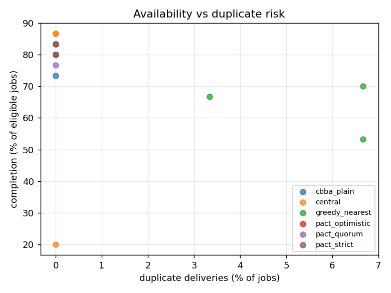

# AeroPACT

**Partition-aware decentralized coordination for drone logistics — ROS 2 Jazzy + Gazebo Harmonic.**

A fleet of delivery drones shares out jobs, recharges, and recovers from failures **without a central
controller**, and stays correct when the radio network partitions. The core contribution is a
layered *ownership protocol* that prevents the split-brain failure where two disconnected drones
both deliver the same parcel:

| Layer | Mechanism | Guarantees |
|---|---|---|
| Replicated state | CRDT fleet replica (join-semilattice merge), delta gossip + anti-entropy | replicas converge under loss, duplication, reordering (I2, I6) |
| Allocation | consensus-based bundle auction (CBBA) with energy, deadline and charging terms | conflicts resolved deterministically; bundle repair |
| Ownership | fenced leases with acknowledged renewals, zombie-stop on the owner's drifting clock | an isolated owner stops before anyone may take over (I3) |
| Partition policy | `STRICT` (shard leases) / `QUORUM` / `OPTIMISTIC_BOUNDED` | tunable availability vs duplicate-risk trade-off |
| Point of no return | picked-up parcels outrank any concurrent re-open | no flapping hand-offs of parcels in flight |
| Physical arbitration | depot hands one parcel per job, only to the newest fencing token | a rare duplicate costs one sortie, never two parcels (I1) |
| Failure handling | phi-accrual detector, indirect probing, failure quorum, endurance bound | "dead" vs "unreachable"; re-order only after DECLARED_FAILED |
| Safety | independent supervisor: geofence, battery floors, separation reflex, watchdog | works with the network off (I4); never imports coordination code |

> **Simulation only.** AeroPACT is research and evaluation software for multi-agent coordination. It
> makes no claim of real-world flight readiness or regulatory compliance.

## Quick start

Ubuntu 24.04 with ROS 2 Jazzy desktop and `ros-jazzy-ros-gz` (native, WSL2, or `docker/Dockerfile`).

```bash
make setup     # optional: Python tooling venv (ruff, mypy, hypothesis) in ~/.cache/aeropact/venv
make build     # colcon build into ~/.cache/aeropact (out of tree)
make test      # unit + property tests
make scenarios # acceptance scenarios AT-03..AT-10 on the full ROS 2 stack (~35 min)
make demo      # Gazebo + RViz: hub loss, partition, drone failure in flight
make bench     # scenario x system x seed sweep -> results/summary.md and plots
```

Run any scenario:

```bash
source ~/.cache/aeropact/install/setup.bash
ros2 launch aeropact_bringup scenario.launch.py scenario:=s3_split_brain system:=pact_strict \
    backend:=gazebo rviz:=true
# headless and fast (kinematic physics, 4x real time):
ros2 launch aeropact_bringup scenario.launch.py scenario:=s1_hub_loss system:=central \
    backend:=kinematic time_scale:=4
ros2 run aeropact_eval metrics ~/.aeropact/runs/s1_hub_loss__central__s42
```

Every run writes `events.jsonl` (structured event log), `metrics.json` and the generated `world/`
(SDF, planning map, bridge config, roster, resolved scenario) to its run directory.

## Workspace

| Package | Language | Role |
|---|---|---|
| `aeropact_interfaces` | IDL | messages, services (`RequestPickup`, `SubmitOrder`, `InjectFault`), action (`FlyRoute`) |
| `aeropact_geometry` | C++ (header-only) | shared geometry |
| `aeropact_core` | C++ | middleware-independent algorithms: replica/merge, ownership, partition policies, auction, energy, failure detector, shards, route planner |
| `aeropact_safety` | C++ | safety supervisor component (separate package; dependency rule enforced by a test) |
| `aeropact_agent` | C++ | coordinator, flight manager (FlyRoute server), lifecycle manager components |
| `aeropact_depot` | C++ | depot node: order intake, parcel and pad arbitration, re-orders |
| `aeropact_baselines` | C++ | central hub planner (`central_full` / `central_hub_loss`) |
| `aeropact_sim` | C++ / Python | radio medium, vehicle plant, proximity sensing, kinematic backend, fault injector, workload generator, world generator, maps |
| `aeropact_eval` | Python | event recorder, metrics + invariant checks, benchmark runner, RViz monitor |
| `aeropact_bringup` | launch / YAML | scenario launch, system presets, scenario suite, acceptance tests |

Every runtime node is a lifecycle-managed `rclcpp` component. Each drone runs its coordinator,
flight manager and safety supervisor in one component container (its "companion computer").

## Verification

| Level | What runs | Covers |
|---|---|---|
| Unit + property (`make test`) | gtest/pytest, deterministic | merge join laws and convergence (20k random cases), I2, zombie-stop under ±1 % drift (300 random timelines), partition policies, auction, energy, failure detector, planner, safety supervisor (incl. a head-on encounter resolved from sensing only), depot arbiters, channel model, world generator determinism |
| Static | ament uncrustify, cpplint, cppcheck, lint_cmake, xmllint, copyright, flake8, pep257 | style and correctness rules, plus the safety-independence rule (I4) as a build-time test |
| Acceptance (`make scenarios`) | the full ROS 2 graph on the kinematic backend | healthy ops, AT-03 split brain, AT-04 zombie stop, AT-05 hub kill vs central, AT-06 drone failure, AT-07 energy, AT-08 safety with the network off, AT-09 clock drift, AT-10 heal and converge |
| Physics | the same graph on Gazebo Harmonic (`backend:=gazebo`) | quadrotors armed, flown and delivering through `MulticopterVelocityControl` |
| Benchmark (`make bench`) | scenario × system × seed | see `results/summary.md` |

## Results (benchmark, 6 drones, 1.2 km district, single seed)

From `make bench` (`results/summary.md`; kinematic backend at 4x real time, 30 jobs per run). One
seed per cell, so treat differences of a few points as noise; the sweep supports more seeds.

| Scenario | central | pact_quorum | pact_strict | pact_optimistic | cbba_plain | greedy_nearest |
|---|---|---|---|---|---|---|
| healthy, on time | 66.7 % | 66.7 % | 66.7 % | 66.7 % | 63.3 % | 40.0 % |
| hub dies at 240 s, on time | **20.0 %** | **66.7 %** | 66.7 % | 70.0 % | 73.3 % | 46.7 % |
| 5-min split brain, on time | 66.7 % | 56.7 % | 66.7 % | 66.7 % | 70.0 % | 56.7 % |
| duplicate deliveries (any scenario) | 0 | 0 | 0 | 0 | 0 | **3.3-6.7 %** |
| frames per drone per minute | 107-124 | 120-125 | 120-125 | 120-126 | 117-124 | 117-124 |

PACT keeps its healthy on-time rate when the hub dies (+47 points over the central baseline,
PRD M1 target +40) and matches the central planner when the hub is alive (M2). No PACT variant
delivered a job twice; the baseline without an ownership protocol did. Every run satisfied the
safety invariants (no collision, no no-fly entry, no airborne battery depletion) except where the
greedy baseline violated I1 by design.



## Documentation

- [docs/ARCHITECTURE.md](docs/ARCHITECTURE.md) — layers, processes, interfaces, protocol details
- [docs/SCENARIOS.md](docs/SCENARIOS.md) — scenario format, fault catalogue, maps, systems
- [docs/OPERATIONS.md](docs/OPERATIONS.md) — building, running, memory budget, troubleshooting
- [docs/EVALUATION.md](docs/EVALUATION.md) — metrics, invariants, acceptance tests, benchmark
- [docs/DECISIONS.md](docs/DECISIONS.md) — design decisions and deviations from the PRD

## License

Apache-2.0. See [LICENSE](LICENSE).
