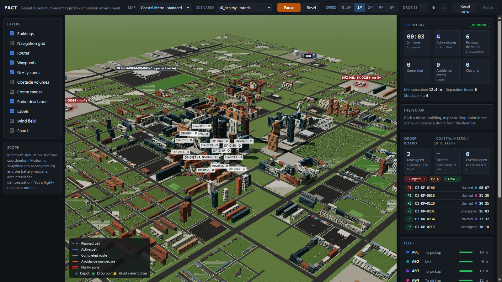
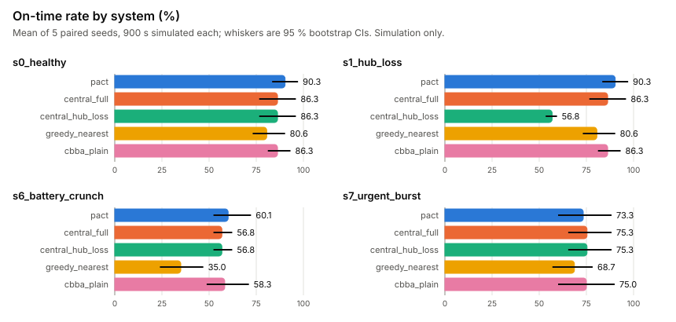
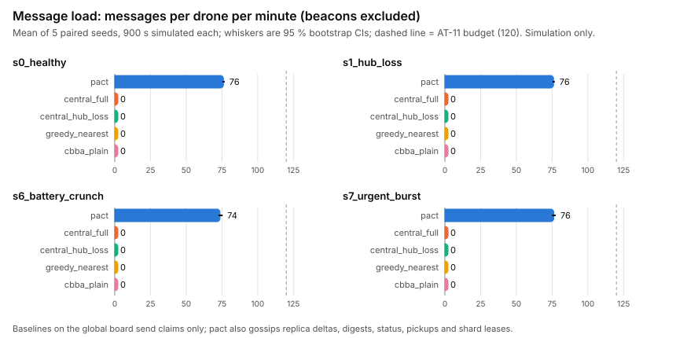
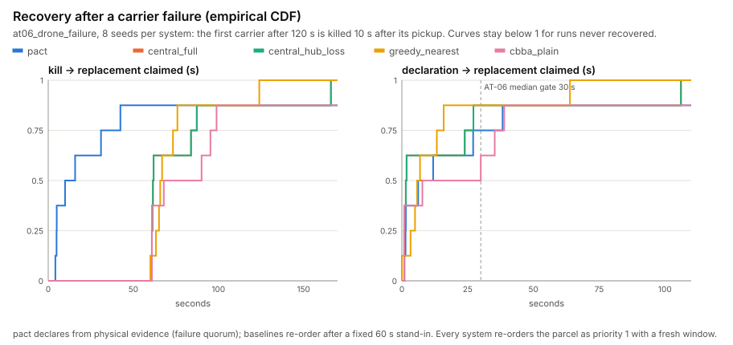
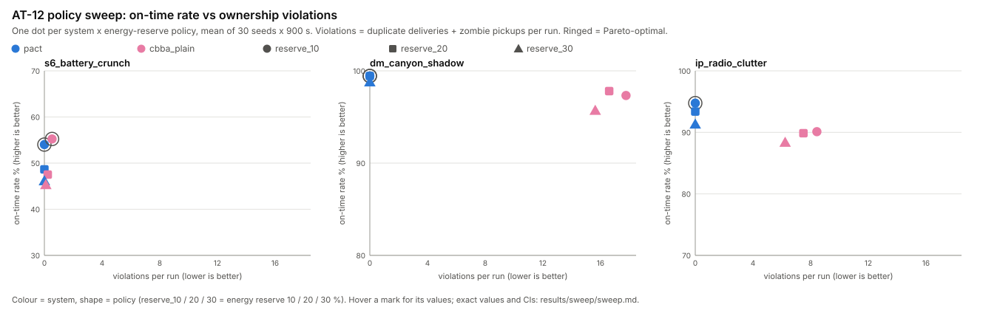

# PACT: Partition-Aware Coordination for Transport

Decentralised drone logistics: a fleet of delivery drones shares out jobs, charges at scarce pads, keeps separation and carries on through faults (closed airspace, storms, radio dead zones, pad outages, drone loss, hub loss) **without a central controller**, and never delivers a parcel twice when the radio splits the fleet. The repo holds the same protocol in two simulators:

| Simulator | Folder | Stack | Use it for |
|---|---|---|---|
| **sim3d** | `sim3d/` | TypeScript, Three.js (React Three Fiber), runs in the browser and headless in Node | Fast deterministic experiments: 8 city maps, ~30 fault scenarios, the benchmark against three baselines, the AT-12 policy sweep, the 3D viewer, the replay viewer and the scripted demo. |
| **AeroPACT** | `aeropact/` | ROS 2 Jazzy (C++ lifecycle components), Gazebo Harmonic, PX4 v1.16 SITL | The protocol as deployable robotics software: one component container per drone, quadrotor physics in Gazebo, real PX4 autopilots in the loop, an authenticated mesh radio transport, deployment launch files. |

> **Simulation only.** Neither simulator is a flight-readiness model, and nothing here has flown. sim3d uses simplified kinematics and an accelerated battery model; AeroPACT runs real autopilot software, but only in simulation.



## What's in the repo

| Path | What it is |
|---|---|
| `sim3d/` | The TypeScript simulator and 3D viewer: Vite, React 18, React Three Fiber, vitest. |
| `aeropact/` | The ROS 2 / Gazebo / PX4 workspace (12 colcon packages), with its own README, docs, decisions log and results. |
| `.github/workflows/` | CI for both: `sim3d.yml` (type check, tests) and `aeropact.yml` (ROS-free core, Python, ROS 2 build + linters). |
| `sim3d/maps/`, `sim3d/scenarios/` | 8 maps (2 to 12 km) and about 30 YAML scenarios. Scenario files are the only way to change behaviour in experiments (NFR-6). |
| `docs/` | Problem statement, assumptions, approach, the agent-first PRD (`04_agent_first_PRD.md`), evaluation plan, risks and `DECISIONS.md`. |
| `results/` | Output of `make bench` (`summary.md`, `results.csv`, `bench.json`), `make sweep` (`sweep/sweep.md`, `.csv`, `.json`) and `make plots` (`plots/*.svg`). |
| `Makefile` | sim3d: `test`, `scenarios`, `lint`, `bench`, `sweep`, `plots`, `demo`. AeroPACT: `gz-build`, `gz-test`, `gz-scenarios`, `gz-scenarios-px4`, `gz-demo`, `gz-bench`. |

The PRD describes a Python package layout (`pact/…`). It is implemented twice: the TypeScript simulator in `sim3d/` (`docs/DECISIONS.md` records where and why it departs from the PRD) and the ROS 2 workspace in `aeropact/` (`aeropact/docs/DECISIONS.md`).

## Quick start: sim3d (browser)

You need Node 18 or newer.

```bash
cd sim3d
npm install
npm run dev          # http://localhost:5173
```

URL options: `?map=<id>&scenario=<name>` picks a world and scenario, `?system=<id>` runs a baseline instead of PACT (also in the toolbar's System picker), `?autostart` starts the run, `?view=overview` and `?cam=px,py,pz,tx,ty,tz` set the camera. For example, to watch the central hub fail at t = 180 s while PACT carries on, open `/?scenario=s1_hub_loss&system=central_hub_loss&autostart` next to `/?scenario=s1_hub_loss&autostart`.

The toolbar has map and scenario pickers, pause/reset, sim speed (0.5x to 8x) and add/remove drone. The side panels show telemetry, the order board, the fleet and an inspector (click any drone, building, depot or drop point).

## Quick start: AeroPACT (Gazebo)

Ubuntu 24.04 (native or WSL2) with ROS 2 Jazzy desktop and `ros-jazzy-ros-gz`, or the image in `aeropact/docker/`.

```bash
make gz-build        # colcon build into ~/.cache/aeropact (out of tree)
make gz-test         # unit, property and lint suites
make gz-demo         # Gazebo + RViz: hub loss, partition, drone failure in flight
make gz-scenarios    # acceptance AT-03..AT-10 on the full ROS 2 graph (~35 min)
# PX4 autopilots in the loop (fetches and builds PX4 v1.16 SITL once, ~25 min):
make -C aeropact px4-toolchain && make gz-build && make gz-scenarios-px4
```

`aeropact/README.md` covers the packages, launch arguments, deployment launches and its benchmark.

## Commands

sim3d targets (the `gz-*` targets are listed above):

| `make` target | npm equivalent (in `sim3d/`) | What it does |
|---|---|---|
| `make test` | `npm test` | Unit and property tests: world generation, maps, scenarios, planner, pads, radio, weather, terrain, baselines, eval (about 2 min). |
| `make scenarios` | `npm run scenarios` | Scenario acceptance suite: every scenario runs headless for 900 simulated seconds against its tier gate, plus the invariants and AT-01 determinism, and the P2P acceptance checks AT-03 / 04 / 06 / 09 / 10 / 11 (`src/scenario/acceptance.scenarios.ts`; about 3 min). `RUN_HEAVY=1` adds the 12 km map to the tier suite. |
| `make lint` | `npm run typecheck` | `tsc --noEmit`. |
| `make bench` | `npm run bench -- --seeds=5 --window=900` | Runs scenario x system x seed and writes `results/` (about 2 min with 5 seeds). Options: `SEEDS=30 WINDOW=900 SCENARIOS=a,b SYSTEMS=x,y`. Exits non-zero if a run breaks I1 or I3; add `--strict` to also fail on AT-05. |
| `make sweep` | `npm run sweep -- --seeds=30 --window=900` | AT-12 policy sweep: partition policy (STRICT / QUORUM / OPTIMISTIC_BOUNDED) under `pact`, plus `cbba_plain` as the unfenced reference, per scenario and seed; writes `results/sweep/` (about 10 min for 240 runs). Options: `SWEEP_SEEDS`, `SWEEP_WINDOW`; `--scenarios=` / `--systems=` / `--references=` on the npm script. Exits non-zero if a run is missing (crashed) or a fenced system breaks I1 / I3. |
| `make plots` | `npm run plots` | Renders `results/plots/bench_on_time.svg`, `message_load.svg`, `recovery_cdf.svg` and `sweep_pareto.svg` from the bench, recovery and sweep JSON (no plotting dependency). |
| `make demo` | `npm run dev -- --open "/?demo"` | Plays the scripted demo (about 5 min, six scenes): healthy fleet, hub loss under the central baseline and under PACT, a radio partition, a drone failure. |

`npm run build` makes a production bundle in `sim3d/dist/`.

## Replay, film mode and the demo (TC-13)

- **Replay viewer** (`?replay`, or the toolbar's Replay button): a timeline over the scenario window with fault, failure, recovery and delivery markers. Click to seek, step 10 s, or jump to the next incident. Runs are deterministic, so seeking re-simulates instead of storing frames. **Save log** writes the run's JSONL event log; **Load log** replays a saved log and verifies it event by event ("Verified: N events identical", or the first event that differs).
- **Film mode** (`?film`): the 3D view without panels, for recordings. `window.pact` scripts it: `shot(eye, target, seconds)`, `caption({tag, title, sub})`, `hud(true)` (system, sim time, deliveries since the first fault, duplicates), `layer`, `follow`, `speed`, `seek`, `skip`, `log()`, `hash()`.
- **Demo** (`make demo`, `?demo`; `?demo=<scene>&once` plays one scene): `src/app/demo.ts`. Captions quote only the numbers in `results/`.

The Gazebo stack has its own film mode, which records a run server-side from a scripted camera (`aeropact/README.md`).

## How coordination works

- **Allocation, no controller:** each idle drone scores the open jobs (priority, distance, lateness, energy, pad contention). Hard constraints are payload and pessimistic energy, which must cover the reserve plus reaching a pad (I5). The drone broadcasts a `CLAIM` over a range-limited radio and backs off if a neighbour outbids it.
- **Ownership:** claims carry an epoch and a lease that the owner renews and the origin depot acknowledges. When a lease lapses before pickup, the old owner stops first (zombie-stop, I3) and only then does the origin depot re-open the job at a higher epoch. The depot hands the parcel only to the highest valid epoch, and ownership is sticky after pickup, so no parcel is delivered twice (I1).
- **Replicated state:** under `pact` every drone and depot keeps its own CRDT replica of the job board and gossips deltas and digests over the simulated radio network (latency, loss, range, partitions, asymmetric links, clock drift). Depots are also linked to each other by a wired / cellular **backhaul**; it only carries the depots' own gossip (drones never use it), so drone state reaches other radio islands by relay through the depots. It is not a coordination hub, it can fail (`backhaul_cut`) and partitions cut it. A partition policy decides whether a drone may claim new work while cut off: STRICT (a live shard lease held on its side), QUORUM (a strict majority of the configured fleet is reachable) or OPTIMISTIC_BOUNDED. Failures are declared only on physical evidence (a quorum of observers that expected to hear the drone, or silence past its endurance). See `docs/P2P_DESIGN.md`.
- **Separation:** drones share intent in their heartbeats and resolve conflicts with a priority order that every drone evaluates the same way. Onboard sensing keeps separation working even with the radio off (I4).
- **Determinism:** fixed 20 Hz steps, seeded RNGs and ordered iteration. The structured JSONL event log is hashed, and two runs with the same scenario and seed must give the same hash (AT-01).

## Benchmark: systems under test (TC-11 / TC-12)

| System | Description |
|---|---|
| `pact` | The decentralised protocol above (the default), with per-node replicas over the network and the scenario's partition policy. |
| `central_full` | A central hub with global knowledge assigns idle drones to jobs (global greedy) every auction period. It never fails, so it is the upper bound. |
| `central_hub_loss` | The same hub, but `kill_service(central_hub)` takes it down. Drones finish the job they hold, then go home. |
| `greedy_nearest` | Decentralised. Each drone grabs the nearest feasible job, with no priorities, deadlines or bids. |
| `cbba_plain` | The same radio auction as `pact`, on an **unfenced** board: no atomic claim, no leases, no depot arbitration. A drone treats a job as free unless it can hear the drone holding it, so claims made out of radio range become duplicate dispatches. It is expected to break I1 / I3, so the bench reports its duplicates but does not gate on them. |

A scenario can set `system:`. The bench runner overrides it so every system runs on the same seeds, worlds, workloads and faults. Metrics come from the event log only. The headline metric is the **on-time rate**: of the jobs that fell due inside the window, the share delivered by their deadline. Means come with 95 % bootstrap CIs. `s1_hub_loss` kills the hub at t = 180 s, and AT-05 checks that PACT degrades by 15 % or less while `central_hub_loss` degrades by more than 40 %. See `results/summary.md` for the latest numbers.



`make bench` (5 seeds x 900 s, 100 runs): fenced systems had 0 duplicate deliveries and 0 zombie pickups; `cbba_plain` had 15 duplicate deliveries over its 20 runs. `pact` on `s0_healthy`: 86.3 % on time, 20.0 deliveries per run (`central_full` 86.3 %, 20.2). AT-05 still fails narrowly on the central side only: `pact` loses nothing under hub loss (86.3 -> 86.3 %), `central_hub_loss` drops 34 % (86.3 -> 56.8 %) against the > 40 % gate; it passes at 1800 s (`docs/DECISIONS.md` Decision 13). Message load: `pact` 74-76 messages per drone per minute besides beacons (budget 120); each depot sends about 143 backhaul copies per minute (3.4 KB/s). Without the depot backhaul, QUORUM over the fleet roster stalls on this map, where the depots are beyond radio range of each other: 0 deliveries (Decisions 19, 20).

Recovery after a carrier failure (`results/recovery.json`, 8 seeds of `at06_drone_failure` per system): `pact` declares the carrier failed 3.7 s after the kill (median) and a replacement is claimed 6.2 s later (one seed of eight was not recovered within 200 s); the baselines wait for their fixed 60 s stand-in, so kill -> replacement claimed is 9.9 s for `pact` against 61.7-67.9 s. Every system re-orders the lost parcel the same way (priority 1, fresh delivery window).





### AT-12 policy sweep

`make sweep` runs the three partition policies (STRICT / QUORUM / OPTIMISTIC_BOUNDED) under `pact`, with `cbba_plain` (no fencing, no policy) once per scenario as the unfenced reference, on two partition scenarios: `at03_split_brain_strict` (6 drones, 5 min partition cutting D1 and its two drones off) and `dm_canyon_partition` (`dm_canyon_shadow` with a 5 min north / south partition added), 30 seeds x 900 s (240 runs, about 10 min). Latest run (`results/sweep/sweep.md`): **AT-12 PASS**, 240/240 runs completed, 0 duplicate deliveries and 0 zombie pickups for `pact` under every policy; the depots refused no pickups (0 wasted sorties) in any cell.

- `at03_split_brain_strict`: on time / delivered per run: STRICT 76.9 % / 28.8, QUORUM 80.8 % / 30.0, OPTIMISTIC_BOUNDED 80.9 % / 31.4. `cbba_plain` 84.1 % / 28.8, with 3.7 duplicate deliveries per run.
- `dm_canyon_partition` (450 m radio, canyon shadows): STRICT 88.6 % / 33.2, QUORUM 82.1 % / 26.4 (the 4 + 4 split leaves no majority side, so nobody claims new work during it), OPTIMISTIC_BOUNDED 82.1 % / 34.6. `cbba_plain` 98.5 % on time but only 23.9 distinct deliveries and 17.8 duplicate deliveries per run.
- The Pareto rings only use on-time rate and violations (duplicates + zombie pickups). CIs are in the sweep table.



## Maps and scenarios

| Map | Size | Tier | Notes |
|---|---|---|---|
| `coastal_metro` | 4 km | standard | PRD example world; S0 healthy, S1 hub loss, S6 battery crunch, S7 urgent burst, zone closure, scripted demo |
| `dense_metro_core` | 2.5 km | hard | Downtown towers, rooftop-only drops, radio shadows, low ceiling |
| `industrial_port` | 3 km | standard | Port and cranes, hub outage, storm front, radio clutter |
| `flatland_rural` | 8 km | standard | Long hauls, gale, pad outages, public pads |
| `river_valley` | 5 km | hard | Hills as obstacles, valley radio shadow, ridge storm |
| `island_archipelago` | 6 km | hard | Islands, over-water legs, sea fog ceiling, gale |
| `harbour_metro_xl` | 12 km | stress | Scalability (30 drones) |
| `coastal_testbed` | 2 km | tutorial | Small fixture for the automated tests, and the P2P acceptance scenarios `at03`/`at04`/`at06`/`at09`/`at10` |

Supported faults include `urgent_job_burst`, `close_zone`, `radio_blackout`, `pad_outage` / `depot_outage`, `weather_front`, `storm_cell`, `altitude_cap`, `battery_drain`, `kill_drone`, `kill_service`, and the network faults `partition` (drone and depot groups; it also cuts the backhaul between depots in different groups), `link_loss` (per-node radio, optionally one direction), `clock_drift` (a node's local clock, in ppm) and `backhaul_cut` (depot backhaul outage). `sim3d/README.md` covers the world generator, scenario schema, tiers and module layout in detail.

## Status and known limits

- Done: deterministic engine, procedural worlds and maps, workload generator, fault injector, energy model, path planner, decentralised allocation with epoch-fenced leases and depot arbitration, safety separation, the network model with partitions and gossip (TC-02/04), per-node CRDT replicas (TC-03), ownership and partition policies (TC-07), depot nodes (TC-08), the failure detector (TC-09), 3D viewer, replay viewer, film mode and scripted demo (TC-13), scenario acceptance suite with the P2P acceptance checks, the baselines, bench runner and AT-12 sweep.
- Depots are assumed to have a backhaul link to each other (`docs/02_assumptions.md` T12). With `network.backhaul.enabled: false`, QUORUM cannot start work on maps whose depots sit beyond radio range of each other (Decision 19).
- The fleet is capped at one drone per charging pad. A scenario asking for more drones runs fewer and logs `fleet_capped`; for example, `s0_healthy` asks for 12 and runs 6.
- The radio is a disc model with dead zones, and planning is 2.5D over altitude layers. Ground vehicles are decorative.
