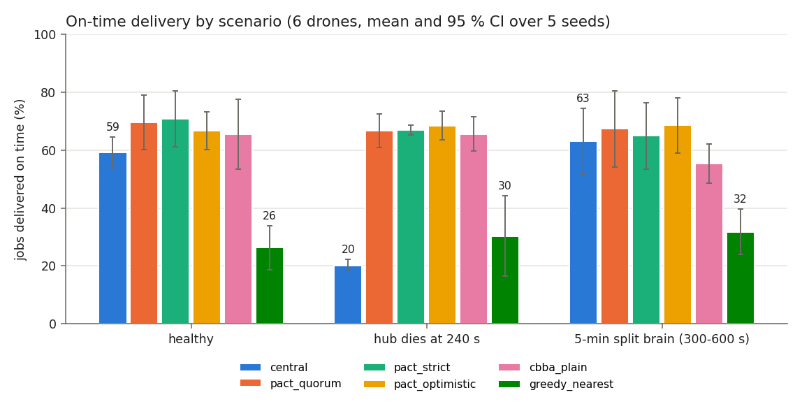
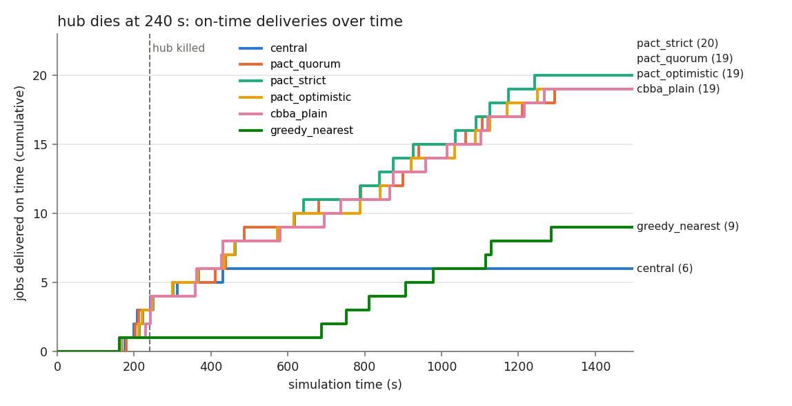
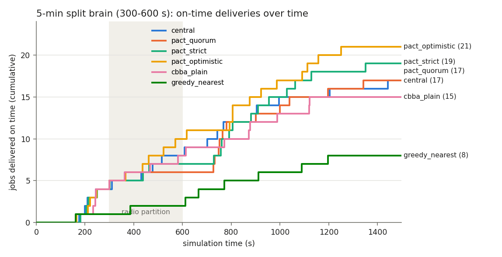

# AeroPACT

**Partition-aware decentralized coordination for drone logistics — ROS 2 Jazzy + Gazebo Harmonic.**

A fleet of delivery drones shares out jobs, recharges, and recovers from failures **without a central
controller**, and stays correct when the radio network partitions. The core contribution is a
layered *ownership protocol* that prevents the split-brain failure where two disconnected drones
both deliver the same parcel:

| Layer | Mechanism | Guarantees |
|---|---|---|
| Replicated state | CRDT fleet replica (join-semilattice merge), delta gossip + anti-entropy | replicas converge under loss, duplication, reordering (I2, I6) |
| Allocation | consensus-based bundle auction (CBBA) with energy, deadline and charging terms | conflicts resolved deterministically; bundle repair |
| Ownership | fenced leases with acknowledged renewals, zombie-stop on the owner's drifting clock | an isolated owner stops before anyone may take over (I3) |
| Partition policy | `STRICT` (shard leases) / `QUORUM` / `OPTIMISTIC_BOUNDED` | tunable availability vs duplicate-risk trade-off |
| Point of no return | picked-up parcels outrank any concurrent re-open | no flapping hand-offs of parcels in flight |
| Physical arbitration | depot hands one parcel per job, only to the newest fencing token | a rare duplicate costs one sortie, never two parcels (I1) |
| Failure handling | phi-accrual detector, indirect probing, failure quorum, endurance bound | "dead" vs "unreachable"; re-order only after DECLARED_FAILED |
| Safety | independent supervisor: geofence, battery floors, separation reflex, watchdog | works with the network off (I4); never imports coordination code |
| Autopilot | PX4 over uXRCE-DDS: offboard arbitration that never contests the autopilot's failsafes | real flight-control software and estimator in the loop (PX4 SITL) |
| Transport | mesh radio bridge: HMAC-SHA256 fleet authentication, replay window | forged, replayed or spoofed frames never reach the protocol |

**Contents:** [Quick start](#quick-start) · [Film mode](#film-mode) · [Testing without ROS](#testing-without-ros) ·
[Workspace](#workspace) · [Verification](#verification) · [Results](#results) ·
[Documentation](#documentation)

> **Not certified for flight.** AeroPACT is research and evaluation software. It runs real PX4
> autopilots in simulation and ships the deployment launch files and procedure
> (summarised in `PACT_02_Technical_Design_Document.docx`, chapter 16), but it makes no claim of flight
> readiness or regulatory compliance. A site needs the hardware-in-the-loop and flight-test
> ladder in that document and an operational authorisation before any vehicle flies.

## Quick start

Ubuntu 24.04 with ROS 2 Jazzy desktop and `ros-jazzy-ros-gz` (native, WSL2, or `docker/Dockerfile`).

```bash
make setup     # optional: Python tooling venv (ruff, mypy, hypothesis) in ~/.cache/aeropact/venv
make build     # colcon build into ~/.cache/aeropact (out of tree)
make test      # unit + property tests
make scenarios # acceptance scenarios AT-03..AT-10 on the full ROS 2 stack (~35 min)
make demo      # Gazebo + RViz: hub loss, partition, drone failure in flight
make bench     # scenario x system x seed sweep -> results/summary.md and plots

# Autopilot in the loop (PX4 v1.16 SITL, no root needed; see `PACT_04_Setup_and_Reproduction_Guide.docx`, chapter 8)
make px4-toolchain   # fetch + build PX4 SITL, the XRCE agent and px4_msgs (~25 min, once)
make build           # rebuild: picks up px4_msgs, builds the PX4 vehicle interface
make scenarios-px4   # acceptance with 4 PX4 autopilots: healthy, motor failure, mesh transport
make rehearsal       # deployment launch files against PX4 SITL over the authenticated mesh
```

Run any scenario:

```bash
source ~/.cache/aeropact/install/setup.bash
ros2 launch aeropact_bringup scenario.launch.py scenario:=s3_split_brain system:=pact_strict \
    backend:=gazebo rviz:=true
# headless and fast (kinematic physics, 4x real time):
ros2 launch aeropact_bringup scenario.launch.py scenario:=s1_hub_loss system:=central \
    backend:=kinematic time_scale:=4
# PX4 SITL autopilots, over the authenticated mesh transport instead of the radio model:
ros2 launch aeropact_bringup scenario.launch.py scenario:=px4_s0_healthy backend:=px4 radio:=mesh
# deployment: one launch per computer, configured by a site file
ros2 launch aeropact_bringup vehicle.launch.py site:=/etc/aeropact/site.yaml vehicle:=A01
ros2 launch aeropact_bringup depot.launch.py site:=/etc/aeropact/site.yaml depot:=D1
ros2 run aeropact_eval metrics ~/.aeropact/runs/s1_hub_loss__central__s42
```

Every run writes `events.jsonl` (structured event log), `metrics.json` and the generated `world/`
(SDF, planning map, bridge config, roster, resolved scenario) to its run directory.

## Film mode

Records a run to video from a scripted camera, rendered by Gazebo server-side in simulation time (no GUI, no
dropped frames), for any scenario on the `gazebo` or `px4` backend:

```bash
ros2 launch aeropact_bringup scenario.launch.py scenario:=demo_hub_loss_partition \
    film:=$(ros2 pkg prefix aeropact_bringup)/share/aeropact_bringup/config/film/demo_hub_loss_partition.yaml \
    film_output:=$HOME/demo.mp4 duration:=405
```

The shot list (`aeropact_eval/shots.py`) keyframes the camera in simulation time: eased fixed shots
(`eye`, `look`) or shots locked onto a drone (`follow`, `offset`). `film_director` moves the `film_camera`
model once per frame through `/world/<name>/set_pose` and pipes the frames to ffmpeg (`ffmpeg:=` may point at a
Windows `ffmpeg.exe` from WSL). `<output>.frames.csv` maps frames to simulation time for captioning against
`events.jsonl`. The world's facades, roofs, sky, shadows and the drones' halo markers are visual only; see D-33.

## Testing without ROS

The coordination algorithms live in `aeropact_core` (C++, no ROS headers) and the evaluation
layer in `aeropact_eval` (Python, only the recorder and RViz monitor import `rclpy`). Both are
testable on any machine, and this is what CI (`.github/workflows/aeropact.yml` at the repo root) runs:

```bash
# Python: event log, metrics, invariants I1/I3/M5, world generator + hypothesis properties
pip install -r requirements-dev.txt
make test-py          # or: PYTHONPATH=src/aeropact_eval python -m pytest tests                       #       src/aeropact_eval/test/test_metrics.py src/aeropact_sim/test/test_world_generator.py

# C++ without ROS: apt install g++ cmake libyaml-cpp-dev libgtest-dev libssl-dev
make test-core        # standalone CMake (ci/core) -> 15 gtest suites (core, autopilot
                      # arbitration + frames, mesh envelope codec), then hypothesis
                      # properties driven against the real CRDT merge via ci/core/merge_oracle
```

The hypothesis suite (`tests/test_crdt_merge_hypothesis.py`) checks the fleet-replica join on
the compiled `merge_task`: idempotence, commutativity, associativity, convergence under any
delivery order with duplicates, the join as an upper bound, the point-of-no-return states as
absorbing, and the shard-lease order as a total order. Failures shrink to a minimal pair of
task versions. Without the oracle binary those tests skip; the rest still run on Windows/macOS.

## Workspace

| Package | Language | Role |
|---|---|---|
| `aeropact_interfaces` | IDL | messages, services (`RequestPickup`, `SubmitOrder`, `InjectFault`), action (`FlyRoute`) |
| `aeropact_geometry` | C++ (header-only) | shared geometry |
| `aeropact_core` | C++ | middleware-independent algorithms: replica/merge, ownership, partition policies, auction, energy, failure detector, shards, route planner |
| `aeropact_safety` | C++ | safety supervisor component (separate package; dependency rule enforced by a test) |
| `aeropact_agent` | C++ | coordinator, flight manager (FlyRoute server), lifecycle manager components |
| `aeropact_depot` | C++ | depot node: order intake, parcel and pad arbitration, re-orders |
| `aeropact_baselines` | C++ | central hub planner (`central_full` / `central_hub_loss`) |
| `aeropact_sim` | C++ / Python | radio medium, vehicle plant, proximity sensing, kinematic backend, fault injector, workload generator, world generator, maps |
| `aeropact_eval` | Python | event recorder, metrics + invariant checks, benchmark runner, RViz monitor |
| `aeropact_px4` | C++ | PX4 vehicle interface (offboard control, arming/mode arbitration, site-frame odometry, autopilot status), SITL instance launcher, fleet PX4 parameters |
| `aeropact_radio` | C++ | mesh radio bridge (UDP multicast/unicast, HMAC-SHA256, anti-replay), fleet key generator |
| `aeropact_bringup` | launch / YAML | scenario launch, deployment launches (`vehicle`, `depot`) with site config, system presets, scenario suite, acceptance tests |

Every runtime node is a lifecycle-managed `rclcpp` component. Each drone runs its coordinator,
flight manager, safety supervisor (and, with PX4, its vehicle interface) in one component
container: its "companion computer".

## Verification

| Level | What runs | Covers |
|---|---|---|
| Unit + property (`make test`) | gtest/pytest, deterministic | merge join laws and convergence (20k random cases), I2, zombie-stop under ±1 % drift (300 random timelines), partition policies, auction, energy, failure detector, planner, safety supervisor (incl. a head-on encounter resolved from sensing only), depot arbiters, channel model, world generator determinism |
| Static | ament uncrustify, cpplint, cppcheck, lint_cmake, xmllint, copyright, flake8, pep257 | style and correctness rules, plus the safety-independence rule (I4) as a build-time test |
| Acceptance (`make scenarios`) | the full ROS 2 graph on the kinematic backend | healthy ops, AT-03 split brain, AT-04 zombie stop, AT-05 hub kill vs central, AT-06 drone failure, AT-07 energy, AT-08 safety with the network off, AT-09 clock drift, AT-10 heal and converge |
| Physics | the same graph on Gazebo Harmonic (`backend:=gazebo`) | quadrotors armed, flown and delivering through `MulticopterVelocityControl` |
| Autopilot in the loop (`make scenarios-px4`) | the same graph with PX4 v1.16 SITL per vehicle (`backend:=px4`) | offboard arbitration, EKF2 estimates, PX4 land detector, flight termination on motor failure, the authenticated mesh transport end to end |
| Deployment rehearsal (`make rehearsal`) | `vehicle.launch.py` / `depot.launch.py` unchanged against PX4 SITL | one launch and one XRCE agent per computer, mesh bridges only, orders through `SubmitOrder` |
| Benchmark (`make bench`) | scenario × system × seed | see `results/summary.md` |

## Results

### Benchmark (6 drones, 1.2 km district, 5 seeds)

From `make bench` (`results/summary.md`): 3 scenarios x 6 systems x 5 seeds, 90 runs of 1500 s
on the kinematic backend at 6x real time, about 30 jobs per run. The table gives the mean on-time
rate with its 95 % CI. Differences inside the intervals are noise.

| Scenario | central | pact_quorum | pact_strict | pact_optimistic | cbba_plain | greedy_nearest |
|---|---|---|---|---|---|---|
| healthy | 59 ± 5 % | 70 ± 10 % | 71 ± 10 % | 67 ± 7 % | 66 ± 12 % | 26 ± 8 % |
| hub dies at 240 s | **20 ± 2 %** | **67 ± 6 %** | 67 ± 2 % | 69 ± 5 % | 66 ± 6 % | 30 ± 14 % |
| 5-min split brain | 63 ± 12 % | 67 ± 13 % | 65 ± 11 % | 69 ± 10 % | **55 ± 7 %** | 32 ± 8 % |
| duplicate deliveries | 0 | 0 | 0 | 0 | 0 | **3-5 %** |
| runs with every invariant held | 15/15 | 15/15 | 15/15 | 15/15 | 15/15 | 0/15 |

- **Hub loss.** PACT keeps its healthy on-time rate when the hub dies, about 47 points above the
  central planner (target: +40). With the hub alive it matches or beats the central
  planner (M2).
- **Partition.** Plain CBBA has no ownership protocol and uses a naive 30 s failure timeout
  (D-22). It recovers slowly: 55 % on time and a median of 674 s to recover. All three PACT
  policies stay at 65-69 % on time with no duplicate delivery.
- **Invariants.** Every PACT run (45 of 45) held every invariant: no duplicate delivery, no
  collision, no no-fly entry, no airborne battery depletion. Greedy-nearest violates I1 by design.
- **What the first sweep found.** A pad-occupancy defect (D-27), a contingency-landing livelock
  (D-28) and a resume bug in the harness. The PX4 rerun then found an arming race (D-29). All
  were fixed and everything was rerun on the final code.

### Autopilot in the loop (PX4 v1.16 SITL, 4 x500 airframes, 700 m test field)

| Check | Result |
|---|---|
| `px4_s0_healthy` (600 s, real time) | 6/6 delivered, 100 % on time, invariants held, ULogs written |
| `px4_s5_drone_failure` | motor cut as PX4 flight termination; DECLARED_FAILED before re-order |
| `px4_s0_healthy` with `radio:=mesh` | 6 delivered, 0 rejected frames on the authenticated transport |
| distributed rehearsal (`vehicle.launch.py` x 2, `depot.launch.py` x 2, 600 s) | 4/4 orders via SubmitOrder delivered on time over the mesh bridges; 0 safety actions, 0 overrides, 0 rejected frames |



**What happens when the hub dies** (seed 1). The central planner stops assigning work the moment its hub
is killed at 240 s; every decentralized variant keeps delivering
at the same pace as before.



**During a 5-minute radio partition** (seed 1). The fleet splits 3/3 (plus one depot each), so neither side
holds a majority: `pact_quorum` stops claiming new work until the heal (the price of never
double-delivering) and then catches up, while `pact_strict` (already-held shard leases) and
`pact_optimistic` (bounded optimistic claims) keep delivering through the partition.




Figures are regenerated from the logged runs with `make plots` (`tools/plot_results.py`, needs
only matplotlib; per-run `results/runs/*/events.jsonl` are kept out of git).

## Documentation

The reviewer documents in [`../docs/submission/`](../docs/submission/) cover AeroPACT alongside sim3d:

- `PACT_02_Technical_Design_Document.docx`: architecture, processes, interfaces, protocol, design decisions, path to hardware
- `PACT_03_Evaluation_and_Results_Report.docx`: metrics, invariants, acceptance tests, benchmark
- `PACT_04_Setup_and_Reproduction_Guide.docx`: building, running, PX4 SITL, troubleshooting

## License

Apache-2.0. See [LICENSE](LICENSE).
